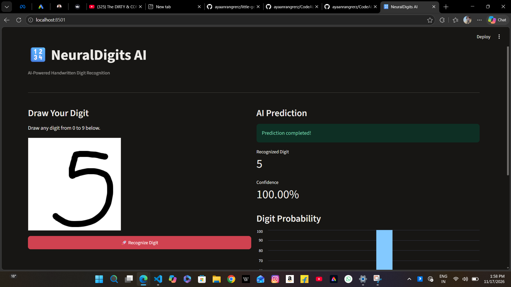
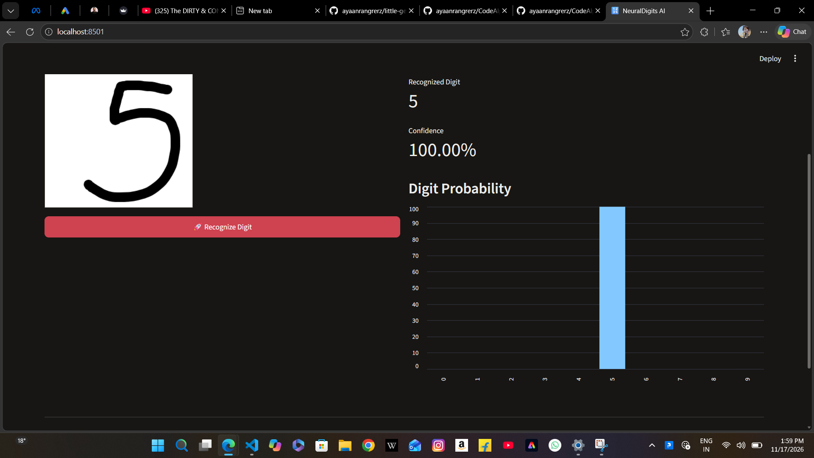

# NeuralDigits AI

<p align="center">
  <strong>Handwritten Digit Recognition with CNN, PyTorch and Streamlit</strong>
</p>

<p align="center">
  
  
  
  
  
</p>

NeuralDigits AI is an interactive handwritten digit recognition application. Draw a digit from **0 to 9** on the Streamlit canvas and a trained Convolutional Neural Network (CNN) predicts the digit, displays its confidence, and visualizes the probability for every class.

## Application screenshots

### NeuralDigits AI dashboard



### Live digit prediction



Launch the app locally and draw a digit from 0 to 9 to try the model.

## Results

| Metric | Result |
|---|---:|
| Dataset | MNIST |
| Model | HandwrittenDigitCNN |
| Training epochs | 5 |
| Batch size | 128 |
| Optimizer | Adam |
| Learning rate | 0.001 |
| Final test accuracy | **99.16%** |

The reported accuracy is from this project's five-epoch training run on the MNIST test split. Results may vary if the model is retrained with different software or hardware environments.

## Features

- Draw digits directly in an interactive Streamlit canvas.
- Predict one of ten classes (0–9) using a trained CNN.
- Display the predicted digit and model confidence.
- Visualize class probabilities for all ten digits.
- Automatically use CUDA when available, otherwise run on CPU.
- Save the trained model weights and training metrics.

## Model architecture

The network accepts normalized grayscale images of shape **1 × 28 × 28**.

1. Convolution: 1 → 32 channels, Batch Normalization, ReLU, Max Pooling.
2. Convolution: 32 → 64 channels, Batch Normalization, ReLU, Max Pooling.
3. Convolution: 64 → 128 channels, Batch Normalization and ReLU.
4. Classifier: Flatten → Fully Connected (128 units) → ReLU → Dropout (0.30) → 10 output classes.

The model is trained with Cross-Entropy Loss and the Adam optimizer. MNIST images are normalized using mean 0.1307 and standard deviation 0.3081.

## Tech stack

- **Language:** Python
- **Deep learning:** PyTorch, Torchvision
- **Interface:** Streamlit, streamlit-drawable-canvas
- **Image processing:** Pillow
- **Data handling:** NumPy, Pandas
- **Dataset:** MNIST

## Project structure

```text
CodeAlpha_HandwrittenCharacterRecognition/
├── app.py                         # Streamlit user interface
├── train.py                       # Model training and evaluation
├── requirements.txt               # Python dependencies
├── models/
│   └── handwritten_digit_cnn.pth  # Trained model weights
├── reports/
│   ├── metrics.json               # Final evaluation metrics
│   └── training_history.json      # Per-epoch training history
├── src/
│   ├── dataset.py                 # MNIST loading and preprocessing
│   ├── model.py                   # CNN architecture
│   └── predict.py                 # Image preprocessing and inference
└── tests/
    ├── test_model.py
    └── test_prediction.py
```

## Getting started

### 1. Clone the repository

```bash
git clone https://github.com/ayaanrangrerz/CodeAlpha_HandwrittenCharacterRecognition.git
cd CodeAlpha_HandwrittenCharacterRecognition
```

### 2. Create and activate a virtual environment

**Windows PowerShell**
```powershell
python -m venv .venv
.\.venv\Scripts\Activate.ps1
```

**macOS / Linux**
```bash
python3 -m venv .venv
source .venv/bin/activate
```

### 3. Install dependencies

For a CPU-only PyTorch installation:

```bash
python -m pip install torch torchvision --index-url https://download.pytorch.org/whl/cpu
python -m pip install -r requirements.txt
```

### 4. Run the application

The repository includes the trained model weights, so you can start the dashboard without training again:

```bash
python -m streamlit run app.py
```

### 5. (Optional) Train the model again

The training script downloads MNIST into the local `data/` directory and trains for five epochs by default.

```bash
python train.py
```

The trained weights are saved to `models/handwritten_digit_cnn.pth`, and metrics are written to `reports/`.

## Run tests

```bash
python -m pytest
```

## Notes

- The MNIST dataset is downloaded automatically when training is started for the first time.
- The `data/` directory is intentionally excluded from version control.
- The trained model weights are included in this repository so the app can run immediately after dependencies are installed.
- This is an educational machine-learning project; predictions can be incorrect, especially for unusual handwriting.

## Acknowledgements

- [MNIST handwritten digit database](http://yann.lecun.com/exdb/mnist/)
- [PyTorch](https://pytorch.org/)
- [Streamlit](https://streamlit.io/)

## Author

**Ayaan Ali**  
GitHub: [@ayaanrangrerz](https://github.com/ayaanrangrerz)

---

Built as part of the CodeAlpha Machine Learning Internship.
